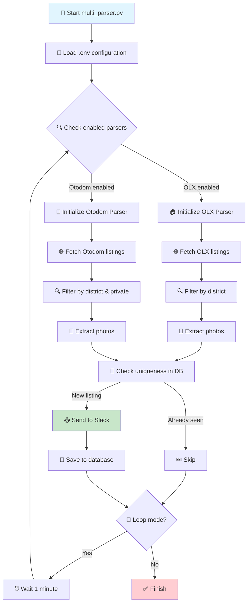

# 🏗️ Architecture Documentation - Warsaw Apartment Parser

## 📋 High-Level Architecture

```
┌─────────────────────────────────────────────────────────────────┐
│                    WARSAW APARTMENT PARSER                     │
├─────────────────────────────────────────────────────────────────┤
│                                                                 │
│  ┌─────────────────┐    ┌─────────────────┐                   │
│  │   multi_parser  │    │   base_parser   │                   │
│  │   (Orchestrator)│────│   (Base Class)  │                   │
│  └─────────────────┘    └─────────────────┘                   │
│           │                       ▲                            │
│           │                       │                            │
│  ┌────────▼────────┐    ┌────────▼────────┐                   │
│  │   olx_parser    │    │  otodom_parser  │                   │
│  │   (OLX.pl)      │    │  (Otodom.pl)    │                   │
│  └─────────────────┘    └─────────────────┘                   │
│                                                                 │
├─────────────────────────────────────────────────────────────────┤
│                        DATA LAYER                              │
│                                                                 │
│  ┌─────────────────┐    ┌─────────────────┐                   │
│  │   SQLite DB     │    │   Slack API     │                   │
│  │  (Uniqueness)   │    │  (Notifications)│                   │
│  └─────────────────┘    └─────────────────┘                   │
│                                                                 │
└─────────────────────────────────────────────────────────────────┘
```

## 🔄 Agent Workflow Diagram



## 🔧 Parser Descriptions

### 1. **BaseParser** (Abstract Base Class)
**Location:** `base_parser.py`

**Responsibilities:**
- Database initialization and management
- Slack webhook integration
- Rate limiting (1 minute intervals)
- Photo extraction from detail pages
- Uniqueness checking
- Common utility methods

**Key Methods:**
```python
- _init_database()           # SQLite schema setup
- _save_listing()           # Store listing with uniqueness check
- send_to_slack()           # Send formatted message to Slack
- _fetch_photo_from_detail_page()  # Extract first image
- _extract_date_from_location()    # Parse dates from location strings
```

### 2. **OLXParser** (OLX.pl Implementation)
**Location:** `olx_parser.py`

**Features:**
- ✅ URL-based filtering (district, price, rooms, furniture, pets)
- ✅ Client-side district filtering for accuracy
- ✅ Handles lazy-loaded images
- ✅ Extracts dates from location strings
- ✅ Filters out "extended search" results

**Search URL Structure:**
```
https://www.olx.pl/nieruchomosci/mieszkania/wynajem/warszawa/q-wola/
?search[filter_float_price:from]=4000
&search[filter_float_price:to]=8000
&search[filter_enum_rooms][0]=three
&search[filter_enum_furnished][0]=yes
&search[filter_enum_pets][0]=yes
&search[private_business]=private
```

**Filtering Logic:**
1. **URL Filters:** District, price, rooms, furniture, pets, private
2. **Client-side:** District verification from location text
3. **Extended Search:** Skip listings with `reason=extended_search`

### 3. **OtodomParser** (Otodom.pl Implementation)
**Location:** `otodom_parser.py`

**Features:**
- ✅ JSON-based data extraction from `__NEXT_DATA__`
- ✅ Client-side filtering (district, private listings)
- ✅ Multi-page support (3 pages = 108 listings)
- ✅ Date extraction from JSON timestamps
- ✅ Fallback selectors for HTML parsing

**Search URL Structure:**
```
https://www.otodom.pl/pl/wyniki/wynajem/mieszkanie/mazowieckie/warszawa
?priceMin=4000
&priceMax=8000
&roomsNumber=%5B3%5D
&areaMin=60
&areaMax=90
&page=1
```

**Filtering Logic:**
1. **URL Filters:** Price, rooms, area (district filtered client-side)
2. **JSON Extraction:** Districts and dates from `__NEXT_DATA__`
3. **Client-side:** Private listings by checking "prywatne" text
4. **Multi-page:** Checks first 3 pages for comprehensive coverage

### 4. **MultiParser** (Orchestrator)
**Location:** `multi_parser.py`

**Responsibilities:**
- Configuration management from `.env`
- Parser initialization and coordination
- URL building for each platform
- Search criteria logging
- Main execution loop

**Configuration:**
```bash
# Parser Selection
RUN_OLX=true
RUN_OTODOM=true
RUN_MODE=once  # or 'loop'

# Search Criteria
DISTRICT_NAME=wola
ROOMS=three
PRICE_FROM=4000
PRICE_TO=8000
AREA_FROM=60
AREA_TO=90

# Slack Integration
SLACK_WEBHOOK_URL=https://hooks.slack.com/...
```

## 🗄️ Database Schema

```sql
CREATE TABLE seen_listings (
    id TEXT PRIMARY KEY,
    title TEXT,
    price TEXT,
    location TEXT,
    url TEXT,
    source TEXT,           -- 'OLX' or 'Otodom'
    image_url TEXT,        -- First photo URL
    created_at TIMESTAMP DEFAULT CURRENT_TIMESTAMP
);
```

## 📤 Slack Message Format

```json
{
  "blocks": [
    {
      "type": "header",
      "text": {
        "type": "plain_text",
        "text": "🏠 New Listing [Source]: Title"
      }
    },
    {
      "type": "section",
      "fields": [
        {"type": "mrkdwn", "text": "*Price:* 5000 zł"},
        {"type": "mrkdwn", "text": "*Location:* Wola, Warszawa - 15 października 2025"},
        {"type": "mrkdwn", "text": "*Link:* <URL|View Listing>"}
      ]
    },
    {
      "type": "image",
      "image_url": "https://...",
      "alt_text": "Listing photo"
    }
  ]
}
```

## 🔄 Data Flow

1. **Configuration** → Load from `.env`
2. **URL Building** → Platform-specific search URLs
3. **Data Fetching** → HTTP requests with rate limiting
4. **Parsing** → HTML/JSON extraction
5. **Filtering** → Client-side criteria matching
6. **Uniqueness Check** → SQLite database lookup
7. **Photo Extraction** → Additional HTTP request if needed
8. **Slack Notification** → Formatted message delivery
9. **Storage** → Save to database for future uniqueness checks

## 🛡️ Error Handling

- **Network Errors:** Retry logic with exponential backoff
- **Parsing Errors:** Graceful degradation, skip problematic listings
- **Database Errors:** Automatic schema migration
- **Slack Errors:** Log failures, continue processing
- **Rate Limiting:** 1-minute intervals between requests

## 📊 Performance Characteristics

- **OLX:** ~30-50 listings per request, 1 request per minute
- **Otodom:** ~36 listings per page × 3 pages = 108 listings, 1 request per minute
- **Database:** SQLite with indexed lookups
- **Memory:** Minimal footprint, processes listings incrementally
- **Network:** ~2-4 HTTP requests per minute (respectful scraping)

## 🔧 Configuration Management

All configuration is externalized to `.env` file:
- Search criteria (districts, price, rooms, etc.)
- Parser selection (OLX/Otodom enabled/disabled)
- Slack webhook URL
- Rate limiting intervals
- Debug settings
